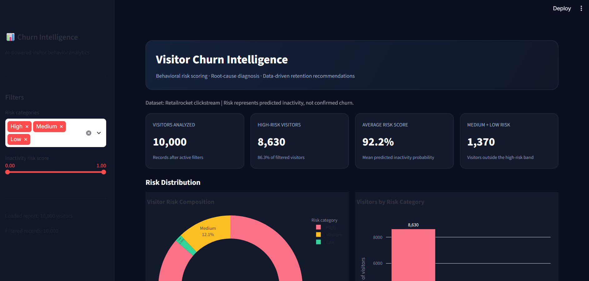
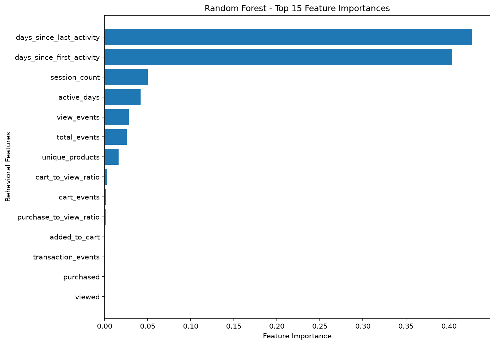

# Agentic User Journey Intelligence & Churn Root-Cause Diagnoser

An end-to-end customer behavior analytics and machine learning project that analyzes clickstream activity, predicts future user inactivity, identifies behavioral risk indicators, and recommends targeted engagement experiments.

## Project Overview

Understanding why users stop returning is important for customer retention and product growth. This project transforms user event data into behavioral features, predicts the risk of future inactivity, and provides an interactive dashboard for investigating individual visitors.

The project combines data engineering, SQL analytics, machine learning, explainability, and a rule-based diagnostic engine.

**Important:** The target represents inactivity over a future 14-day window. It is a churn proxy, not confirmed business churn.

## Key Features

- Data validation, cleaning, and quality checks on clickstream events
- Customer journey and session analysis
- SQL-based analytics using DuckDB
- Behavioral feature engineering
- Logistic Regression and Random Forest model comparison
- Chronological train-test evaluation
- Feature-importance analysis
- Visitor risk segmentation into High, Medium, and Low categories
- Rule-based root-cause indicators and engagement recommendations
- Interactive Streamlit dashboard
- Visitor-level investigation reports and CSV export

## Technology Stack

- **Language:** Python
- **Data analysis:** Pandas, NumPy
- **Database and SQL:** DuckDB, SQL
- **Machine learning:** Scikit-learn
- **Visualization:** Matplotlib, Seaborn, Streamlit
- **Model persistence:** Joblib
- **Interface:** Streamlit

## Project Workflow

1. Inspect and validate raw event data.
2. Clean events and handle data-quality issues.
3. Analyze customer journeys, sessions, and activity patterns.
4. Build an analytical database and run SQL queries.
5. Engineer visitor-level behavioral features.
6. Create a time-based inactivity prediction dataset.
7. Train and compare classification models.
8. Evaluate performance on a chronological holdout set.
9. Generate feature-importance results and visitor risk reports.
10. Investigate risk indicators and display findings in the dashboard.

## Model Evaluation

The initial chronological holdout evaluation produced the following results:

| Metric | Logistic Regression | Random Forest |
|---|---:|---:|
| Accuracy | 74.22% | 92.14% |
| Precision (class 1) | 98.61% | 97.97% |
| Recall (class 1) | 74.59% | 93.88% |
| F1-score (class 1) | 84.94% | 95.88% |
| ROC-AUC | 0.7249 | 0.6921 |

Class 1 represents predicted inactivity.

Although Random Forest achieved higher accuracy and class-1 recall, its ROC-AUC was lower. The dataset is highly imbalanced, so accuracy alone is not sufficient to select the best model. The minority class and the intended business use case must also be considered.

These are initial evaluation results, not a claim of production-ready performance.

## Root-Cause Diagnosis

The diagnostic engine examines behavioral signals such as:

- Time since the visitor's last activity
- Number of sessions and active days
- Product views and browsing activity
- Cart activity without a recorded transaction
- Repeat-visit patterns

Based on these indicators, the system produces possible explanations, recommended engagement actions, and suggested experiments.

These explanations are rule-based hypotheses, not proof of causation.


## Dashboard

The Streamlit dashboard provides risk distribution summaries, risk-score visualization, root-cause analysis, visitor search, individual investigation, and report export.



### Feature Importance




## Repository Structure

```text
Agentic-Churn-Intelligence/
├── dashboard.py
├── requirements.txt
├── README.md
├── .gitignore
├── src/
│   ├── inspect_data.py
│   ├── validate_data.py
│   ├── clean_data.py
│   ├── customer_journey.py
│   ├── session_analysis.py
│   ├── build_analytics_db.py
│   ├── run_sql_analysis.py
│   ├── build_churn_dataset.py
│   ├── train_churn_model.py
│   ├── evaluate_churn_models.py
│   ├── explain_churn_model.py
│   ├── root_cause_diagnoser.py
│   └── local_visitor_investigator.py
├── sql/
│   └── customer_intelligence.sql
├── data/
│   └── (local datasets and database; not committed)
├── models/
│   └── (local trained models; not committed)
└── reports/
    └── figures/
```

## Getting Started

### 1. Clone the repository

```bash
git clone <YOUR_GITHUB_REPOSITORY_URL>
cd Agentic-Churn-Intelligence
```

### 2. Create a virtual environment

```bash
python -m venv .venv
```

Activate it on Windows:

```powershell
.\.venv\Scripts\Activate.ps1
```

### 3. Install dependencies

```bash
python -m pip install -r requirements.txt
```

### 4. Prepare the data and model artifacts

The raw dataset, processed datasets, DuckDB database, and trained model files are not included in this repository. Obtain the dataset from its permitted source and place it in the expected local data directory. Run the project scripts in the required pipeline order to generate the artifacts used by the dashboard.

The exact dataset source, expected filename, and any licensing conditions should be documented before publishing.

### 5. Launch the dashboard

```bash
python -m streamlit run dashboard.py
```

## Limitations and Future Improvements

- The inactivity label is a proxy and may not represent confirmed customer churn.
- Class imbalance affects minority-class detection and model selection.
- Behavioral associations do not establish causal reasons for inactivity.
- Recommendations require controlled experiments to measure their effectiveness.
- Further work could include probability calibration, stronger temporal validation, and monitored retention experiments.

## Author

Developed as an end-to-end data science portfolio project demonstrating data preparation, SQL analytics, machine learning, model evaluation, and interactive reporting.